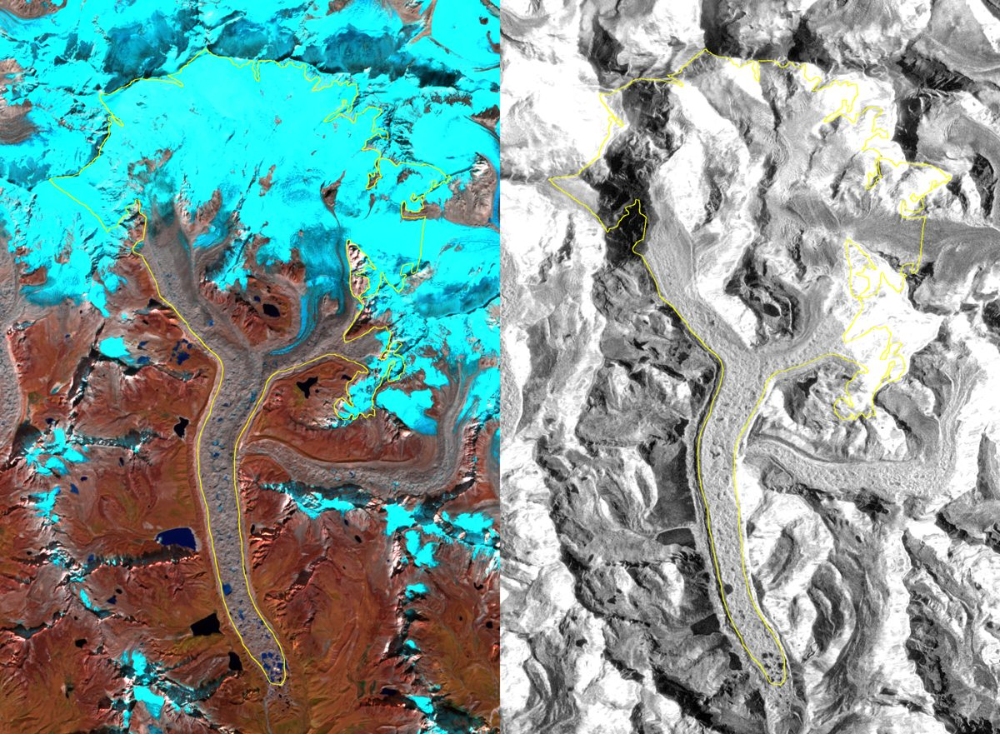

<div align="center">

# CryoRisk

**Satellite monitoring of Himalayan glacier change and hazards: outlines, meltwater ponds, crevasse fields and surface velocity from Sentinel-1/-2.**

[](https://github.com/binit-ai/Cryorisk/actions/workflows/ci.yml)




<sub>Ngozumpa Glacier, Oct–Nov 2023. <b>Left:</b> Sentinel-2 SWIR/NIR/red. <b>Right:</b> Sentinel-1 VV. <b>Yellow:</b> RGI v7 outline.</sub>

</div>

---

## Contents

[Features](#features) · [Study area](#study-area) · [Input stack](#input-stack) · [Tech stack](#tech-stack) · [Quick start](#quick-start) · [CLI](#cli-reference) · [Testing](#testing) · [Structure](#project-structure) · [Contributing](#contributing) · [License](#license)

## Features

| Capability | Description | Status |
|---|---|---|
| **Data ingestion** | Cloud-masked, seasonal Sentinel-1/-2 + DEM stacks for any RGI glacier via the Earth Engine API | Working |
| **Aligned grids** | One fixed 10 m UTM grid per glacier, so years, sensors and labels line up pixel-for-pixel | Working |
| **Flexible export** | Straight to Google Drive or tile-downloaded to disk, with a manifest per run | Working |
| **Surface velocity** | Sub-pixel cross-correlation, validated against synthetic displacement tests | In progress |
| **Assisted labelling** | SAM masks seeded from RGI outlines, then corrected by hand | Planned |
| **Glacier segmentation** | DeepLabV3+ (clean vs debris-covered ice), benchmarked against RGI with IoU | Planned |
| **Hazard detection** | RF-DETR for meltwater ponds and crevasse fields | Planned |
| **Trend analysis** | PostGIS storage + SQL views for area, pond and velocity trends | Planned |

## Study area

There are nine debris-covered and clean-ice glaciers in the Everest (Khumbu) region. They are **split by glacier**, so the test score measures performance on glaciers the model has never seen.

| Split | Glaciers | Count |
|---|---|:---:|
| **Train** | Ngozumpa · Lhotse · Nuptse · Changri Shar/Nup · Bhote Kosi · Melung | 6 |
| **Val** | Imja–Lhotse Shar | 1 |
| **Test** | Khumbu · Hungu–Merala | 2 |

RGI v7 IDs are in [`configs/glaciers.yaml`](configs/glaciers.yaml).

## Input stack

Each glacier-year has one post-monsoon (Oct 1 – Nov 30) composite.

| Property | Value |
|---|---|
| Grid | EPSG:32645 (UTM 45N), 10 m |
| Format | 12-band int16 GeoTIFF, nodata `-32768` |
| Years | 2016 – 2025 |

| Bands | Source | Processing |
|---|---|---|
| `B2` `B3` `B4` `B8` `B11` `B12` | [Sentinel-2 SR](https://developers.google.com/earth-engine/datasets/catalog/COPERNICUS_S2_SR_HARMONIZED) | [Cloud Score+](https://developers.google.com/earth-engine/datasets/catalog/GOOGLE_CLOUD_SCORE_PLUS_V1_S2_HARMONIZED) mask, median |
| `NDSI` `NDWI` | Derived from S2 | Normalised differences |
| `VV` `VH` | [Sentinel-1 GRD](https://developers.google.com/earth-engine/datasets/catalog/COPERNICUS_S1_GRD) | Dominant orbit pass, median, dB |
| `elevation` `slope` | [Copernicus GLO-30](https://developers.google.com/earth-engine/datasets/catalog/COPERNICUS_DEM_GLO30_2024_1) | Bilinear to 10 m |

Each run records its per-band scale factors in a `manifest_*.json` file.

## Tech stack

| Area | Tools |
|---|---|
| Language & packaging | Python 3.11 · [uv](https://docs.astral.sh/uv/) · [hatchling](https://hatch.pypa.io/) |
| Earth observation | [earthengine-api](https://developers.google.com/earth-engine/guides/python_install) · [geemap](https://geemap.org/) |
| Geospatial | [rasterio](https://rasterio.readthedocs.io/) · [GeoPandas](https://geopandas.org/) · [Shapely 2](https://shapely.readthedocs.io/) · [pyproj](https://pyproj4.github.io/pyproj/) |
| CLI & config | [Typer](https://typer.tiangolo.com/) · [Pydantic v2](https://docs.pydantic.dev/) · YAML |
| ML *(planned)* | [PyTorch](https://pytorch.org/) · [segmentation-models-pytorch](https://github.com/qubvel-org/segmentation_models.pytorch) · [RF-DETR](https://github.com/roboflow/rf-detr) · [SAM 2](https://github.com/facebookresearch/sam2) |
| Storage *(planned)* | PostgreSQL 16 + [PostGIS](https://postgis.net/) · SQLAlchemy · GeoAlchemy2 |
| Quality | pytest · [ruff](https://docs.astral.sh/ruff/) · GitHub Actions |

## Quick start

### Prerequisites

| Requirement | Notes |
|---|---|
| macOS or Linux | Developed on Apple Silicon |
| Google account | With an [Earth Engine-enabled Cloud project](https://developers.google.com/earth-engine/guides/access) (free for noncommercial use) |
| ~2 GB disk | For local stacks. Drive exports need a similar amount |

### Install

```bash
git clone https://github.com/binit-ai/Cryorisk.git && cd Cryorisk

curl -LsSf https://astral.sh/uv/install.sh | sh        # uv, no sudo
uv venv --python 3.11 .venv && source .venv/bin/activate
uv pip install -e ".[dev]"
```

### Configure

| Setting | Where | Example |
|---|---|---|
| Earth Engine project | `.env` (git-ignored), or an exported `CRYORISK_GEE_PROJECT` | `CRYORISK_GEE_PROJECT=my-project` |
| Season / years / CRS | `configs/project.yaml` | `season: {start: "10-01", end: "11-30"}` |
| Glaciers & splits | `configs/glaciers.yaml` | `split: test` |

```bash
cp .env.example .env     # then set your Earth Engine project id
cryorisk auth            # one-time browser login
```

### First run

```bash
cryorisk rgi fetch                                       # outlines -> data/rgi/
cryorisk ingest --aoi ngozumpa --years 2023 --to local   # -> data/raw/ngozumpa/2023/stack.tif
cryorisk inspect data/raw/ngozumpa/2023/stack.tif        # sanity-check the bands
```

## CLI reference

| Command | Purpose |
|---|---|
| `cryorisk auth` | Log in to Earth Engine |
| `cryorisk glaciers` | List study glaciers, splits and RGI ids |
| `cryorisk rgi search [NAME]` | Find RGI v7 glaciers in the region by name |
| `cryorisk rgi fetch` | Download outlines for configured glaciers |
| `cryorisk availability` | Sentinel-1/-2 scene counts per year and per season |
| `cryorisk ingest` | Build and export stacks (see options below) |
| `cryorisk tasks` | Earth Engine export task status |
| `cryorisk inspect PATH` | Per-band coverage and value ranges |

**`ingest` options:**

| Option | Default | Description |
|---|---|---|
| `--aoi` | all glaciers | Glacier name or slug (repeatable) |
| `--years` | `2016-2025` | `2023`, `2016-2025` or `2018,2020` |
| `--to` | `drive` | `drive` (Google Drive `cryorisk/` folder) or `local` |
| `--dry-run` | off | Print grid sizes and storage estimate only |
| `--force` | off | Re-export even if a manifest exists |

## Testing

| Command | Scope | Needs |
|---|---|---|
| `pytest` | Unit tests: config, grids, band scaling, CLI | Nothing (offline) |
| `pytest -m gee` | Live Earth Engine checks | `cryorisk auth` |
| `ruff check src tests` | Lint | Nothing |

CI runs lint and the unit tests on every push.

## Project structure

| Path | Contents |
|---|---|
| `configs/` | `project.yaml` (CRS, season, GEE project) · `glaciers.yaml` (RGI ids, splits) |
| `src/cryorisk/cli.py` | `cryorisk` entry point |
| `src/cryorisk/config.py` | Pydantic-validated YAML config |
| `src/cryorisk/gee/` | Auth, RGI search/fetch, availability, stack building, export |
| `src/cryorisk/data/` | AOI grids, stack inspection |
| `tests/` | pytest suite (`gee` / `db` markers for live tests) |
| `scripts/legacy/` | Original exploration scripts |
| `docs/img/` | Figures |
| `data/` | Local outputs, gitignored |

## Contributing

This is a personal research project, but issues and suggestions are welcome.

| Step | |
|---|---|
| 1 | Branch off `main` |
| 2 | Run `ruff check src tests && pytest` before pushing. CI runs the same checks |
| 3 | Keep commits focused, and note any new Earth Engine assets or config keys in the PR |

## License

No license has been chosen yet, so all rights are reserved by the author. Please open an issue if you'd like to reuse the code.
